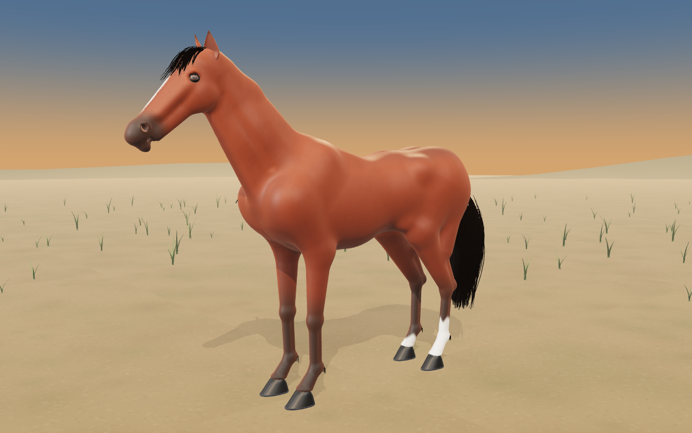
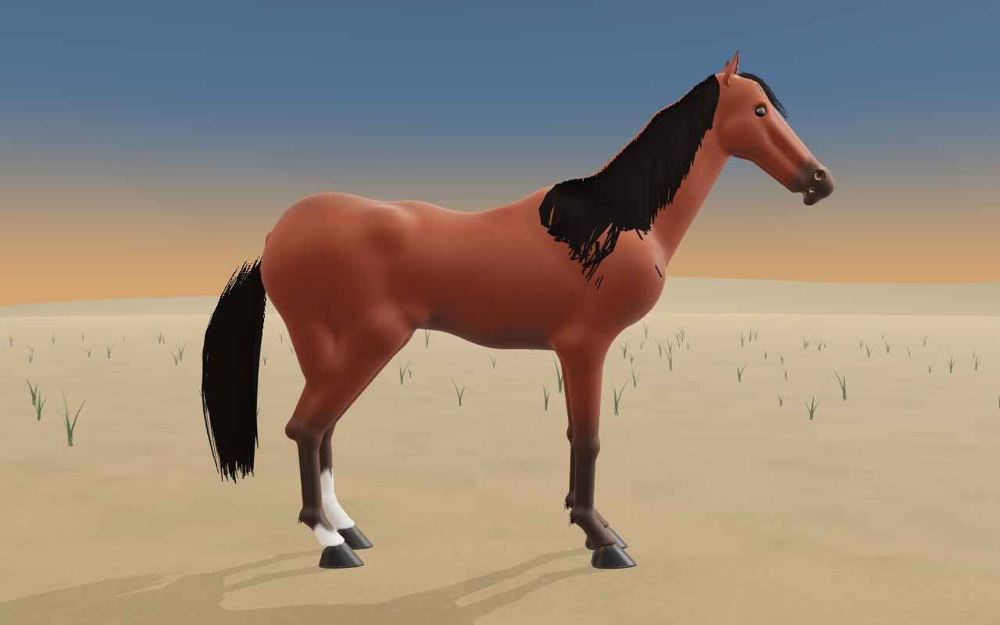
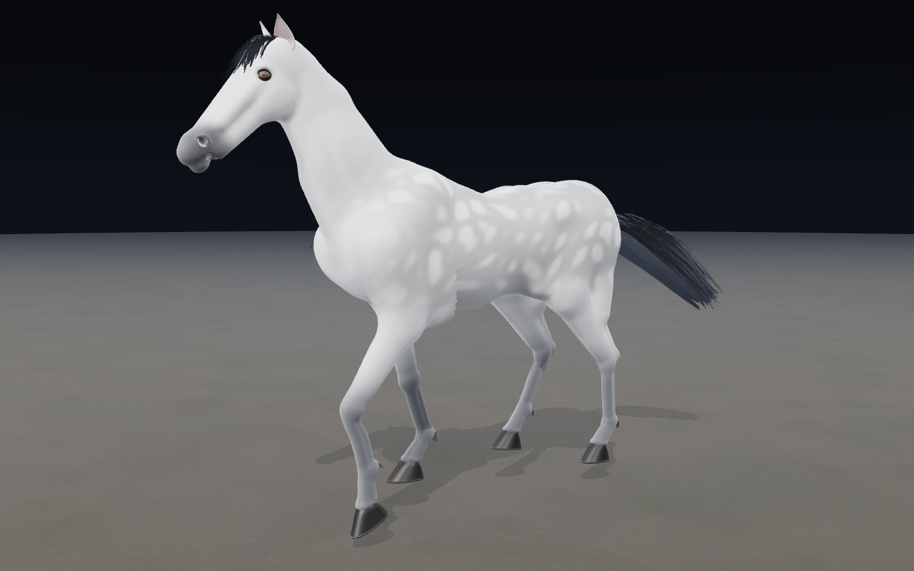

# Equus — Realistic 3D Horse in Three.js

An anatomically sculpted, animated 3D Warmblood/Thoroughbred horse built procedurally in pure **Three.js** with zero external 3D model assets.



## Key Features

- **Seamless Analytic SDF + Surface Nets Body** (`src/horse/horseSDF.js`, `src/horse/sdfEngine.js`):
  - Single watertight, seam-free sculpted `THREE.SkinnedMesh` built via sparse 8×8×8 block-culled Surface Nets, Taubin volume-preserving smoothing, Newton zero-isosurface projection, exact analytic gradient normals, and stretch-free triplanar UVs.
  - 16-hand Warmblood proportions: high withers, sloping scapulae, balanced pectoral chest, jugular groove, rounded masseter jowl, supraorbital arches, recessed orbital sockets, flared nostrils, sculpted lips, muscular hindquarters, flexor tendon grooves, sharp hocks, and ~53°/55° sloped pasterns.
- **Fine Anatomical Details** (`src/horse/headGeometry.js`, `src/horse/legGeometry.js`, `src/horse/hairGeometry.js`):
  - Lateral equine eyes with procedural walnut-amber iris fibers, authentic horizontal bar pupils, wet clearcoat corneas, eyelashes, and blinking eyelids.
  - Double-walled concave tulip-shaped ears parented to independent ear bones.
  - Striated keratin hooves with forged-steel horseshoes resting flush on `y = 0`.
  - Layered flowing mane (360 ribbons), forelock (58 ribbons), tail (280 ribbons), and fetlock tufts projected strictly outside the body SDF to prevent clipping.
- **Procedural PBR Coats** (`src/horse/materials.js`):
  - 1024×1024 directional short-horsehair albedo, bump, and roughness maps paired with linear-calibrated 3D anatomical vertex pigmentation and grazing-angle velvet sheen.
  - 5 breed-authentic coats: **Blood Bay**, **Dapple Gray**, **Friesian Black**, **Golden Palomino**, and **Copper Chestnut**.
- **39-Bone Skeletal Rig & Biomechanical Gaits** (`src/horse/anatomy.js`, `src/horse/gaitAnimation.js`):
  - **Idle** (breathing ribcage, gaze sweep, independent ear swivels, blinking, tail swish), 4-beat **Walk**, 2-beat diagonal **Trot**, asymmetric **Gallop**, and show **Stance**.
- **Interactive Viewport & Lighting** (`src/main.js`, `src/environment.js`):
  - Smooth OrbitControls, camera presets (`3/4 Hero`, `Side`, `Head`, `Front`, `Rear`, `Top`), 3 lighting environments (`Golden Hour`, `Equine Studio`, `Soft Meadow`), animation speed slider, and keyboard shortcuts (`1`–`5` gaits, `Space` pause/resume, `R` reset camera).

| Right Profile (Flowing Mane) | Dapple Gray Trot (Studio) |
| :---: | :---: |
|  |  |

## Quick Start

No build step required — run with Node's built-in server or any static HTTP server:

```bash
npm start
# or: python3 -m http.server 8080
```

Then open [http://127.0.0.1:8080](http://127.0.0.1:8080) in your browser.
